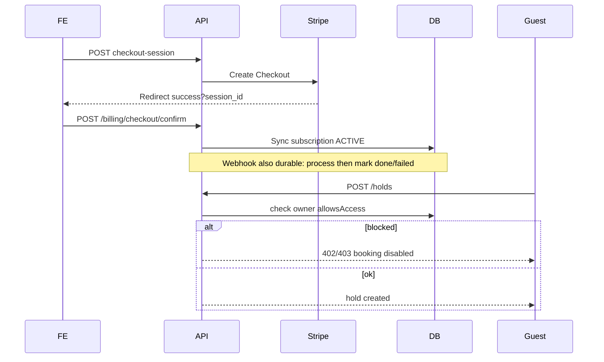

# Production-ready remediation plan

**Status:** Phase 0–2 code done · Phase 3 artifacts exist but CI parked / VPS not cut over · Phase 4 mostly done  
**Source audits:** [README.md](README.md), [flows.md](flows.md), [backend/audit.md](backend/audit.md), [frontend/audit.md](frontend/audit.md), [product-doctrine.md](product-doctrine.md)  
**Updated:** 2026-10-12 (docs rescore; CI location = `.github/ci-parked/`)

Fix every audit/flow finding so Mesaro is post-deploy production-ready: money/trust P0s, STAFF floor autonomy, complete advanced modules (planning/vacations/reports), vision-aligned go-live UX with Dashboard as home, and ops/CI/legal hardening.

**Automation goal:** expand Cursor with MCPs so the agent does deploy/DNS/CI/browser checks; you only approve payments, secrets, and legal.

---

## Live runtime audit — 2026-10-09 (historical)

> **Do not treat this section as current product status.** It is the pre-remediation snapshot that drove Phase 0–2.  
> Current scores and open blockers: [README.md](README.md) (2026-10-12). Most P0/P1 rows below are **fixed in code**.

**Stack:** `run-dev.ps1` · FE `http://localhost:3000` · API `http://localhost:8080`  
**Accounts:** `admin@demo.com` / `demo123` (OWNER) · `staff.demo@demo.com` / `demo123` (STAFF)  
**Clock:** ~00:20 Europe/Brussels — no Lunch/Dinner window active (expected “Sin turno activo”)

### Verified working (as of 2026-10-09)

| Area | Evidence |
|------|----------|
| Owner login → Dashboard home | Browser `/dashboard` with today’s reservations + table map |
| Guest availability | `/r/demo-restaurant` → Lunch/Dinner slots for 2026-10-09 |
| Guest hold → confirm | `POST /api/holds` → `POST /api/holds/confirm` → `RES-2026-X8EAZFFX` |
| Planning API | `GET /api/restaurants/1/staff-planning?date=…` returns shifts + assignments |
| Planning UI (after interaction) | “Hoy” loads week strip, assign UI, weekly hours |
| Vacations (OWNER) | Staff tab lists pending/approved/rejected seed rows; approve/reject controls |
| Reports UI + API | Summary cards, daily trend, today timeline; `GET /api/reports/summary?restaurantId=1&…` |
| Tables / shifts / staff / admin reservations | Restaurant-scoped GETs 200 |
| Billing status read | `GET /api/restaurants/1/billing/status` → `TRIALING`, `accessAllowed: true` |
| Restaurant select API exists | `POST /api/restaurants/2/select` returns new access token |

### Verified broken / incorrect (as of 2026-10-09) → remediation

| Severity | Finding (then) | Status now (2026-10-12) |
|----------|----------------|-------------------------|
| **P0** | Billing success did not call confirm | **Fixed** — `BillingSuccessPage` → `confirmCheckout` |
| **P0** | Stripe webhook mark-before-process | **Fixed** — claim → route → done/failed |
| **P0** | No Privacy / Terms routes | **Fixed** — `/privacy`, `/terms` (+ footer); counsel still pending |
| **P1** | STAFF cancel / switch 403 | **Fixed** — service + FE STAFF+ |
| **P1** | STAFF self-vacation 403 | **Fixed** — STAFF self-only create |
| **P1** | Guest booking not billing-gated | **Fixed** — hold/confirm check billing access |
| **P1** | Seed `maxRestaurants` vs 2 restaurants | **Fixed** — seed sets `max_restaurants = 2` |
| **P1** | Restaurant `/select` unused in FE | **Fixed** — wired in `restaurant-context` |
| **P2** | Planning first paint empty | **Fixed** — cold-load to today |
| **P2** | Closures / i18n / slot seconds / overnight copy | Partially addressed in Phase 2/4; some i18n polish remains |

### Demo logins (dev seed)

| Email | Role | Password |
|-------|------|----------|
| `admin@demo.com` | OWNER (restaurants 1+2) | `demo123` |
| `manager.demo@demo.com` | MANAGER | `demo123` |
| `staff.demo@demo.com` | STAFF | `demo123` |

---

## Cursor add-ons (expand agent power — do less manual work)

These are **Cursor plugins / MCP servers**, not Hostinger product SKUs. Authenticate once; then the agent can call them instead of you clicking hPanel/GitHub/Stripe dashboards.

### Must enable / auth (highest leverage for this plan)

| Cursor add-on | Status in this workspace | What the agent can do without you |
|---------------|--------------------------|-----------------------------------|
| **Hostinger VPS** MCP | Installed (`hostinger-vps`) | List/manage VMs, firewall, snapshots, SSH keys, metrics |
| **Hostinger DNS** MCP | Installed | Create/update DNS, SSL-related zone work |
| **Hostinger Domains** MCP | Installed | Domain inventory / nameservers |
| **Hostinger Hosting** MCP | Installed | Static/Node site deploy if FE is on shared hosting |
| **Hostinger Billing** MCP | Installed | See subscriptions/orders (agent won’t purchase without your yes) |
| **Browser** (`cursor-ide-browser`) | Built-in | Smoke-test live site, booking flow, billing return pages |
| **GitHub CLI (`gh`)** | Use in terminal | PRs, Actions, secrets on repo once `gh auth login` |

**Your one-time Cursor setup:** open each Hostinger MCP → run auth (`mcp_auth` / API token) until status is ready. Without that, deploy/DNS stay manual in hPanel.

### Strongly recommended to add

| Add-on | Why it cuts your manual work |
|--------|------------------------------|
| **GitHub MCP** (official) | Agent manages Actions, secrets, PR checks without leaving Cursor |
| **Sentry MCP** (or similar) | Agent reads prod errors after deploy instead of you digging logs |
| **Stripe MCP** (community/official if available) | Agent can verify products/webhooks/customers; you still create the account once |

### Nice-to-have

| Add-on | Why |
|--------|-----|
| **Docker MCP** / remote SSH | Cleaner VPS container ops from Cursor |
| **Resend MCP** (if exists) | Agent verifies email sends / domains |
| **Playwright in CI** (not MCP) | Agent writes workflow; GitHub runs E2E |

### Already enough for coding (no install needed)

Shell, tests, file edits, docs — Phase 0–2 **code** does not require Hostinger. MCPs matter most from **Phase 3 deploy** onward.

### What still cannot be automated by any Cursor add-on

- Paying for VPS/domain/Stripe  
- Creating Stripe/Resend accounts the first time (KYC)  
- Lawyer approval of Privacy/Terms  
- First-time OAuth “Allow Cursor” on each MCP  
- Typing secrets into a password manager / approving spend  

---

## Locked product decisions

| Decision | Choice |
|----------|--------|
| Cancel / switch tables | **STAFF+** (floor autonomy) |
| Planning / vacations / reports | **Essential** — keep in nav, **fully implement** in Phase 2 (not hide, not “verify only”) |
| Primary floor | **Dashboard** (timeline + list remain secondary) |

**Doctrine:** [product-doctrine.md](product-doctrine.md) amended 2026-10-09 — advanced modules stay in default nav; marketing still sells the simple €50 daily product (no suite jargon).

---

## Assumed defaults (change only if you object later)

- **Unpaid owners:** hard-block guest `holds` + `confirm` when `!allowsAccess()` (also set/clear `bookingEnabled` on cancel/expire for clarity).
- **Accept invite:** require set-password for new users before issuing long-lived session.
- **Restaurant context:** FE calls `POST /restaurants/{id}/select` + scoped access token (**done**).
- **Legal:** Privacy + Terms founder drafts live; “review with counsel” checklist remains before paid ads.
- **Deploy:** **Hostinger VPS** running Docker (`docker-compose.prod.yml` hardened) + Caddy/nginx TLS; frontend static on same VPS or Hostinger static site. **Not** Shared hosting for the Java API (no Spring Boot + Postgres + Redis there).
- **Out of scope still:** deposits, SMS, marketplace, plan matrices (doctrine).

---

## Infrastructure accounts (separate from Cursor add-ons)

Still required to *run* production (payment/KYC — not Cursor plugins):

| Account | Why |
|---------|-----|
| **Hostinger VPS** (≥2–4 GB, Docker) | Spring API + Postgres + Redis |
| **Domain** | `api.` / `app.` / marketing |
| **Stripe** | €49.99 subscriptions |
| **Resend** (or SMTP) | Transactional email |
| **GitHub** (recommended) | CI Actions |

Shared Hostinger web hosting alone cannot run the Java API.

### Topology once MCPs are authed

```text
You (once)                      Cursor agent (automated via MCP/shell)
──────────────────────────      ─────────────────────────────────────
Auth Hostinger MCPs       →     VPS + DNS + SSL + static FE
Buy VPS + domain          →     docker compose + reverse proxy
Stripe + Resend secrets   →     env on VPS, webhook URL, smoke email
gh auth / GitHub MCP      →     Actions, repo secrets, PR checks
Browser MCP (built-in)    →     post-deploy booking/billing smoke
```

---

## What YOU must do manually (minimal)

### Before coding starts (optional)

Nothing — agent can implement Phases 0–2 in the repo without Hostinger.

### Before first live deploy

1. **Auth Hostinger MCPs in Cursor** (VPS, DNS, Domains, Hosting, Billing) — one Allow click each.  
2. **Order VPS + domain** (agent can guide; purchase needs your confirmation).  
3. **Stripe + Resend accounts** → paste keys into chat or local `.env.prod` (never commit).  
4. **`gh auth login`** (or GitHub MCP auth) for CI secrets.  
5. **Legal skim** of Privacy/Terms drafts; counsel before paid ads.

### Ongoing

Almost nothing: say “continue phase N”. Interruptions only for spend approval, new secrets, or legal.

---

## Target architecture (money + access)



---

## Phase 0 — Production gate (block paid traffic until green)

**Money**

1. [x] Fix webhook durability in `backend/.../StripeWebhookController.java`: status machine (`processing` → `done` / `failed`) or process-then-mark; reclaim stale `processing`/`failed` so Stripe retries work.
2. [x] Wire `frontend/.../BillingSuccessPage.tsx` to `POST /api/billing/checkout/confirm?session_id=`; loading/error/retry UI; fix `billing-success.spec.ts`.
3. [x] Gate guest booking: `HoldService` + confirm path call billing access (owner of restaurant); expired → no new holds/confirms.
4. [x] Prod fail-fast startup: reject `insecure-dev-*`, blank Stripe secrets when billing enabled, `EMAIL_PROVIDER=log` outside `dev`.
5. [x] Fix **dev seed billing quota** so `maxRestaurants` / Stripe quantity ≥ active restaurant count (or seed only one restaurant).

**Trust / legal**

6. [x] Add `/privacy` and `/terms` routes + footer links; consent banner links to Privacy; fix FAQ guest-cancel copy; strip Redis/audit jargon from pricing.
7. [ ] Configure real email (Resend/SMTP) smoke: invite, reset, confirmation. *(Provider wiring exists; prod smoke not verified in this pass.)*

**Exit criteria:** checkout → success confirms ACTIVE; webhook failure recoverable; guest cannot book unpaid restaurant; prod refuses insecure boot; legal pages linked; seed quota consistent.

---

## Phase 1 — Core floor + auth flows

**STAFF autonomy (locked)**

8. [x] BE: change `@PreAuthorize` on `cancel` + `switchTables` in `ReservationAdminService.java` from MANAGER → STAFF.
9. [x] FE: open `cancelReservation` + `switchTables` in `permissions.ts` to STAFF; verify `ReservationActions`.
10. [x] Tests: unit + one integration path for STAFF cancel/switch.

**Invite / tenant**

11. [x] Accept-invite set-password: BE accept API accepts optional/required password for new users; FE `AcceptInvitePage` collects password when needed.
12. [x] Wire `restaurant-context.tsx` to call `selectRestaurant` API + `setScopedAccessToken`; keep `X-Restaurant-Id` as secondary.
13. [x] 402 UX: non-OWNERS get clear “billing blocked — contact owner” instead of OWNER-only billing redirect trap (`client.ts`).

**Logout / tokens**

14. [x] On logout, denylist access JWT (parity with role-change) via existing denylist service.

**Exit criteria:** waiter can run full floor night; invitee can re-login; restaurant switch uses scoped token; 402 safe for staff.

---

## Phase 2 — Planning, vacations, reports **fully implemented** (+ Dashboard home)

Locked: these three are **essential product** — keep in default nav and ship as complete weekly ops, not stubs or “verify only.”  
Scope stays simple (no HR suite / BI warehouse). Each module below has a **done checklist**; Phase 2 is incomplete until every checkbox is true.

### 2A — Planning (full)

**Must work for:** MANAGER/OWNER assign; STAFF read-only week view.

15. [x] **First paint:** init `selectedDate` to **today** (not weekStart); load week as soon as `selectedRestaurantId` is set; never show false 0s when API has data.
16. **Day plan:** for each day — shifts, assigned staff (with time windows), available staff, unavailable (vacation/closure) reasons.
17. **Assign:** single-day assign + remove assignment; optional start/end within shift; conflict errors surfaced in UI (vacation/closure/overlap).
18. **Recurring week:** “assign for whole week” creates matching assignments; partial success message (`assignedCount/7`) is accurate; closed days skipped cleanly.
19. **Weekly hours:** list planned vs assigned hours; MANAGER can set/save planned hours; STAFF can see own/team hours as designed.
20. **Empty / closed states:** restaurant closed day, Sunday-without-shifts, and no-staff cases have clear copy (not blank cards).
21. **Tests + E2E:** BE unit/integration for assign + recurring + hours; FE E2E: open `/planning` → data visible without clicking Hoy → MANAGER assign → STAFF can open read-only.

**Planning done when:** cold-load shows today’s week; MANAGER can staff a service night end-to-end; STAFF can open and understand coverage; no 403 for allowed roles.

### 2B — Vacations & closures (full)

**Must work for:** STAFF request own leave; MANAGER/OWNER approve/reject and manage closures.

22. [x] **STAFF self-request:** `VacationService.createStaffVacation` allows STAFF for **own** `userId` only; MANAGER+ for others. Align FE form + permissions.
23. **Approve / reject:** MANAGER+ can approve/reject pending requests; status, actor, notes visible; list filters pending vs resolved.
24. **Closures:** create / edit / delete restaurant closures; Closures tab never a silent blank (seed ≥1 demo closure **or** honest empty-state CTA). Closures block availability and cancel/affect bookings per existing BE rules; FE shows impact.
25. **Overlap / validation:** date range, overlap with existing vacation/closure, and membership checks return clear field errors in UI.
26. **Notifications:** request / approve / reject / closure emails (or documented outbox) fire consistently; audit events recorded.
27. **Tests + E2E:** BE tests for STAFF self vs MANAGER-other; FE E2E: STAFF request → MANAGER approve; OWNER create closure → guest availability closed that day.

**Vacations done when:** STAFF can request leave without 403; MANAGER can approve/reject; closures manage holidays end-to-end; guest cannot book closed days.

### 2C — Reports (full)

**Must work for:** MANAGER/OWNER. Not a BI suite — complete **ops summary** product.

28. **Period summary:** totals (reservations, covers, avg party, no-show %, cancel %) for chosen range; status breakdown; daily trend chart — all from real API (no fake zeros when data exists).
29. **Today strip:** today’s reservation schedule on the reports page stays correct for selected restaurant/date.
30. **CSV export:** download works for the selected range; columns match summary semantics; empty range = clear message (not corrupt file).
31. **Print:** print layout usable (summary + breakdown); no clipped charts-only blank page.
32. **Range UX:** presets (7/30/90/MTD) + date pickers; invalid range (start > end) blocked with i18n message; locale-safe date display.
33. **i18n:** status badges and labels follow selected locale (no EN “Confirmed” while nav is ES).
34. **Auth:** MANAGER+ only; STAFF get Access Denied with clear copy (not a broken empty page).
35. **Tests + E2E:** BE summary/CSV tests; FE E2E: open `/reports` → change preset → export CSV → print dialog path smoke.

**Reports done when:** MANAGER can answer “how did we do last month?” and export CSV without empty/wrong states or i18n leaks.

### 2D — Dashboard as home (supporting)

36. Post-login / AppShell default → `/dashboard` (**already default in live**); timeline + reservations stay secondary (“Views”).
37. Soften “Sin turno activo” when the day has reservations (show next shift / day totals).
38. Soften go-live friction: guided checklist deep-links tables → shifts → enable booking → copy link.

**Phase 2 exit criteria (all required):**

- [x] Planning cold-load works; assign + recurring-week + work-hours complete; STAFF read OK  
- [x] Vacations: STAFF self-request + MANAGER approve/reject + closures CRUD/impact complete  
- [x] Reports: summary + trend + CSV + print + presets + i18n + role gate complete  
- [x] Dashboard is home; overnight capacity copy sane  
- [ ] E2E covers planning cold-load, STAFF vacation request, reports CSV *(CI E2E job still Phase 3.)*


---

## Phase 3 — Ops, CI, deploy hardening (Hostinger VPS)

39. [x] GitHub Actions workflows authored: `backend-ci.yml` (`mvn test` / Testcontainers) — **parked** at `.github/ci-parked/` until Actions are enabled.
40. [x] E2E workflow authored (starts infra + API + Playwright) — **parked** at `.github/ci-parked/e2e.yml`. Unpark to `.github/workflows/` when ready; require status checks on `main`.
41. Harden `backend/docker-compose.prod.yml` for VPS: **bind DB/Redis to localhost only** (drop public `15432`/`16379`/`19200`); disable Elasticsearch for v1 unless RAM ≥4 GB; add Caddy/nginx reverse proxy with TLS.
42. Agent deploy runbook: SSH/API to Hostinger VPS → `docker compose --env-file .env.prod up -d` → health checks; DNS A records + SSL via Hostinger DNS MCP when domain is on Hostinger.
43. Monitoring: Actuator/prometheus scrape notes + alert stubs (webhook failures, outbox dead-letters, 5xx).
44. Outbox: keep confirmation path; either implement or stop enqueueing stub events (`HoldExpired`, `PasswordResetRequested`, etc.) to avoid false reliability.
45. Frontend: `vite build` → static host on VPS or Hostinger static site with `VITE_API_URL=https://api.<domain>`.

**Exit criteria:** CI green; VPS stack private data plane; HTTPS live; agent can redeploy without hPanel; runbooks in `docs/`.

---

## Phase 4 — Polish that audits called out (still production)

46. [x] i18n: dashboard live table status tags + `document.documentElement.lang`; register/billing/consent leaks remain partial.
47. [x] Guest cancel deep-link: confirmation email uses `app.frontend-url` + `/r/{slug}/reservation/{code}?cancelToken=`; FE reads `cancelToken` and legacy `token`.
48. [x] Guest slot time format `HH:mm` (drop seconds in UI; API times unchanged).
49. [ ] Opening-hours close vs closures: document behavior in Settings UI (warn-only vs closure cancels); optional “create closure instead” CTA — no silent mass cancel on hours edit.
50. [x] Remove dead FE (`BookingPage`, `route-placeholders.tsx`); rename `RegisterPlaceholderPage` → `RegisterPage`.
51. [x] PAST_DUE policy: **7-day grace** from first `invoice.payment_failed` (`user_account.past_due_since`), then guest booking / billing-guarded access blocked like UNPAID; recovery on payment clears timestamp. Dunning email still open.
52. [x] Refresh audit/flow docs after each phase; re-score readiness in [README.md](README.md) *(2026-10-12)*.

---

## Deliberately NOT in this plan (still out of scope)

Deposits, SMS/WhatsApp, waitlist, marketplace/OTAs, guest loyalty, multi-plan entitlements, analytics warehouse (either disable fake endpoint or leave log-only behind flag).

---

## Suggested delivery order

```text
Week 1: Phase 0 (money/trust/boot + seed quota)
Week 2: Phase 1 (STAFF floor + invite + select + 402)
Week 3–4: Phase 2 (FULL planning + vacations + reports + Dashboard)
Week 5: Phase 3–4 (CI/deploy/docs/i18n/email deep-links)
```

Phase 2 is a **full implementation** week(s), not a polish pass — block Phase 3 until the Phase 2 checklists are green.

---

## Definition of “post-deploy production ready”

- Paid signup works even if webhook is delayed or fails once
- Unpaid restaurants cannot take new online bookings
- STAFF can run service including cancel/switch
- **Planning fully usable** (cold-load, assign, recurring week, work-hours)
- **Vacations/closures fully usable** (STAFF request, approve/reject, closures impact booking)
- **Reports fully usable** (summary, trend, CSV, print, presets, i18n, role gate)
- Dashboard is the default floor
- Prod cannot boot insecure; email real; Privacy/Terms linked
- CI tests backend + meaningful E2E (including the three weekly modules)
- Deploy surface hardened + runbooks exist
- Dev seed billing quota matches restaurant count

---

## Phase checklist

- [x] Phase 0 — money / trust / boot / seed quota *(item 7 prod email smoke pending)*
- [x] Phase 1 — STAFF floor + invite + select + 402
- [x] Phase 2A — **Planning fully implemented**
- [x] Phase 2B — **Vacations/closures fully implemented**
- [x] Phase 2C — **Reports fully implemented**
- [x] Phase 2D — Dashboard home polish
- [x] Phase 3 — CI / deploy / monitoring / outbox *(workflows authored but **parked** under `.github/ci-parked/`; hardened compose + Caddy + runbooks exist; live VPS cutover still needs secrets/purchase)*
- [x] Phase 4 — polish + docs rescore *(46–48, 50, 52 done; 49 opening-hours UX + 51 PAST_DUE policy remain)*
